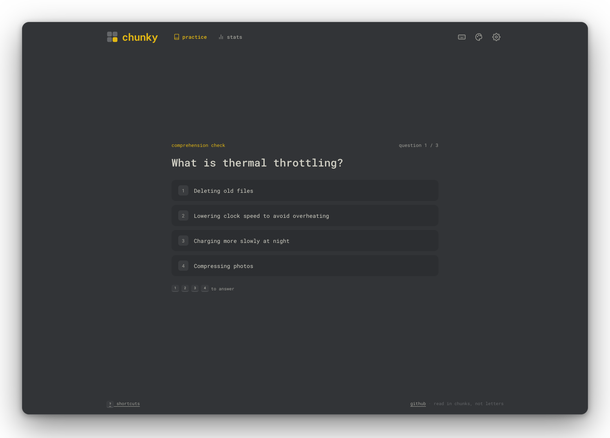

<p align="center">
  
</p>

<p align="center">
  <a href="https://abhinav-prabhakar.github.io/Chunky/"></a>
  <a href="#the-loop"></a>
  
  
  <a href="https://github.com/Abhinav-Prabhakar/Chunky/stargazers"></a>
</p>

<p align="center">
  <b>read faster. prove you understood it.</b><br>
  <sub>rsvp word chunks &nbsp;·&nbsp; comprehension quizzes &nbsp;·&nbsp; stats that keep you honest</sub>
</p>


<h3 align="center">3,000 wpm ceiling &nbsp;·&nbsp; 1–4 word chunks &nbsp;·&nbsp; 5 modes &nbsp;·&nbsp; 16 achievements &nbsp;·&nbsp; 0 accounts</h3>

## the loop

Reading speed is limited by eye movement, not by your brain. Chunky removes the movement:
one chunk per fixation, aligned on a pivot letter, at whatever pace you set.

Change speed or chunk width mid-session and the text rebuilds around the word you were on.
Nothing restarts. Nothing is lost.

<p align="center">
  
</p>

<p align="center"><sub><b>520 wpm</b>, 2-word chunks, pivot on. the yellow letter is where your eye lands first.</sub></p>

## does it stick?

Every passage ends with a recall check, a one-line explanation for each answer, and a drill
for whatever you missed. Speed you can't remember doesn't count.

<p align="center">
  
</p>

<p align="center"><sub>measured recall, not vibes.</sub></p>

## the numbers

Effective wpm is raw speed multiplied by comprehension, so a 900 wpm skim loses to a
600 wpm read. Every session, chunk size, streak and personal best is logged locally —
and exportable when you want to take it somewhere else.

<p align="center">
  
</p>

<p align="center"><sub>raw speed, comprehension, effective wpm, personal best.</sub></p>

<p align="center">
  
</p>

<p align="center"><sub>speed over time &nbsp;·&nbsp; best by chunk size &nbsp;·&nbsp; speed vs comprehension &nbsp;·&nbsp; 26-week heatmap</sub></p>

## themes

Twelve themes and a custom accent. Dark first; light when the sun is up.

<p align="center">
  
  &nbsp;&nbsp;&nbsp;
  
</p>

## run it

No build step. No dependencies. No account.

```sh
git clone https://github.com/Abhinav-Prabhakar/Chunky.git
cd Chunky
python3 -m http.server 4173
```

Then open <http://127.0.0.1:4173>. Or just use the
[live build](https://abhinav-prabhakar.github.io/Chunky/).

<p align="center">
  <kbd>space</kbd> start / pause &nbsp;
  <kbd>←</kbd> <kbd>→</kbd> speed &nbsp;
  <kbd>↑</kbd> <kbd>↓</kbd> chunk size &nbsp;
  <kbd>b</kbd> peek &nbsp;
  <kbd>r</kbd> restart &nbsp;
  <kbd>t</kbd> theme &nbsp;
  <kbd>f</kbd> fullscreen &nbsp;
  <kbd>?</kbd> all shortcuts
</p>

<details>
<summary><sub>project structure</sub></summary>

```text
index.html          practice, quiz, results and stats
css/style.css       the design system, tokens per theme
js/passages.js      bundled passages, questions, explanations
js/engine.js        pure logic: chunking, ORP, pacing, scoring, streaks
js/app.js           reader loop, quiz, results, stats, routing
manifest.json       PWA manifest
sw.js               network-first service worker
assets/icon.svg     app icon
```

`js/engine.js` has no DOM access, so `buildChunks`, `orpIndex`, `effectiveWpm`,
`computeStreaks` and `scoreSession` can be tested in isolation. Everything persists
under `chunky.*` keys in `localStorage`, with JSON/CSV export and JSON import.

</details>

<p align="center">
  <br>
  <a href="https://abhinav-prabhakar.github.io/Chunky/"><b>try it live →</b></a><br>
  <sub>no setup, no sign-up, works offline. if it makes you faster, star the repo.</sub>
</p>
