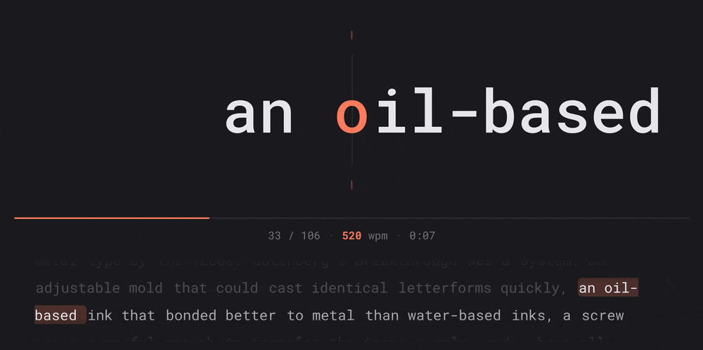
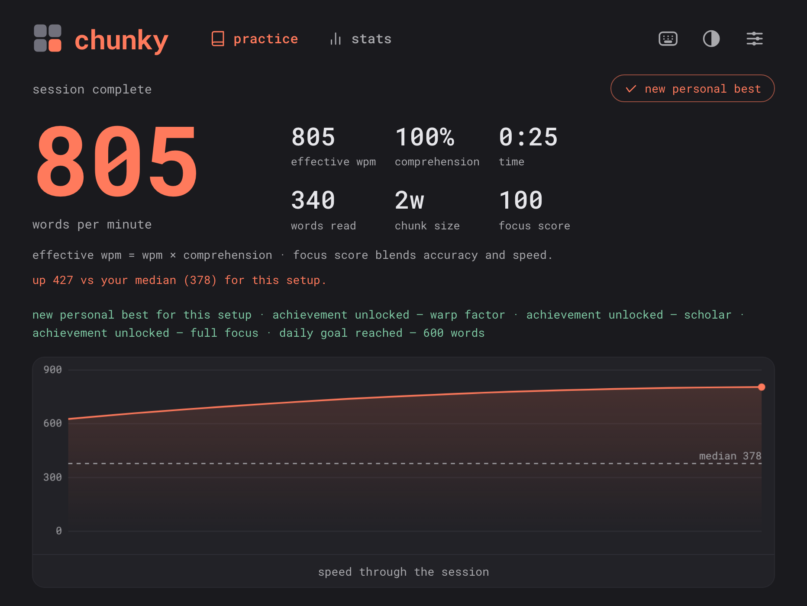
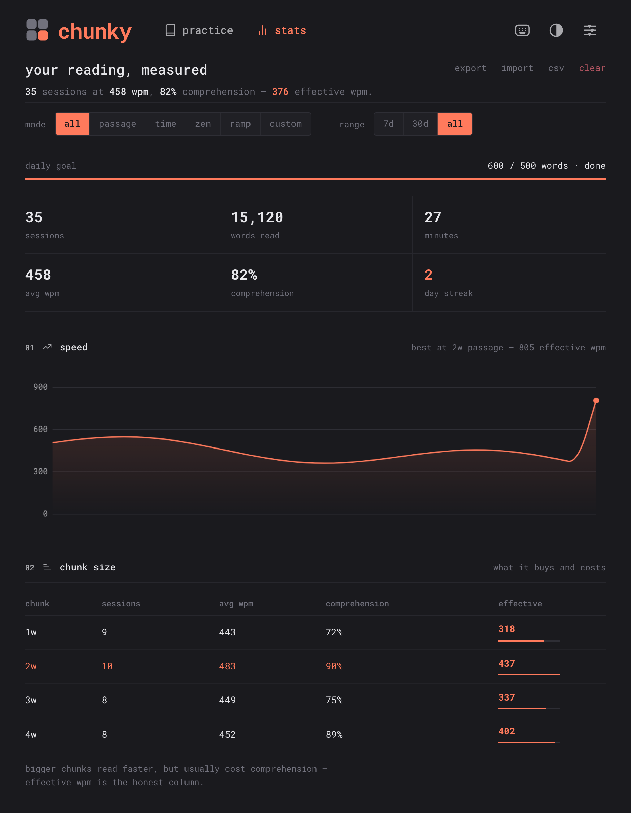
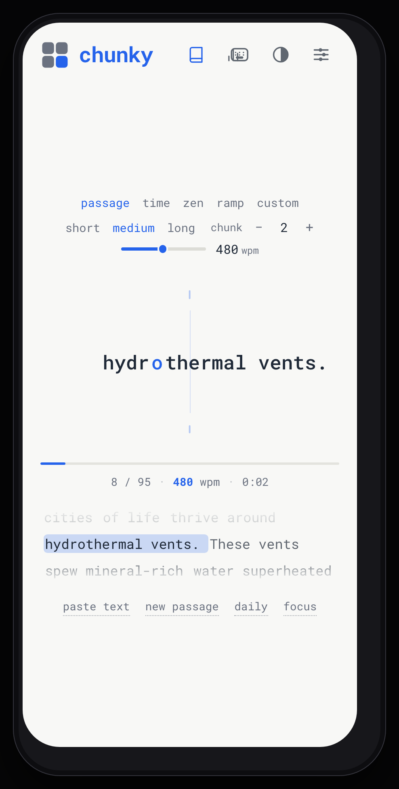

<p align="center">
  
</p>

<p align="center">
  <a href="https://abhinav-prabhakar.github.io/Chunky/"></a>
  <a href="#the-loop"></a>
  
  
  <a href="https://github.com/Abhinav-Prabhakar/Chunky/stargazers"></a>
</p>

<p align="center">
  <b>Read faster. Prove you understood it.</b><br>
  <sub>RSVP word chunks &nbsp;·&nbsp; comprehension quizzes &nbsp;·&nbsp; stats that keep you honest</sub>
</p>


<h3 align="center">3,000 wpm ceiling &nbsp;·&nbsp; 1–4 word chunks &nbsp;·&nbsp; 5 modes &nbsp;·&nbsp; 16 achievements &nbsp;·&nbsp; 0 accounts</h3>

## The loop

Eye movements put a floor under how fast you can read. Chunky removes the movement:
one chunk per fixation, aligned on a pivot letter, at whatever pace you set. Whether
your brain kept up is what the quiz is for.

Change speed or chunk width mid-session and the text rebuilds around the word you were on.
Nothing restarts. Nothing is lost.

<p align="center">
  
</p>

<p align="center"><sub><b>520 wpm</b>, 2-word chunks, pivot on. The coral letter is where your eye lands first.</sub></p>

## Does it stick?

Every passage ends with a recall check, a one-line explanation for each answer, and a drill
for whatever you missed. Speed you can't remember doesn't count.

<p align="center">
  
</p>

<p align="center"><sub>Measured recall, not vibes.</sub></p>

## The numbers

Effective wpm is raw speed multiplied by comprehension, so a 900 wpm skim loses to a
600 wpm read. Every session, chunk size, streak and personal best is logged locally —
and exportable when you want to take it somewhere else.

<p align="center">
  
</p>

<p align="center"><sub>Raw speed, comprehension, effective wpm, personal best.</sub></p>

<p align="center">
  
</p>

<p align="center"><sub>Mode and range filters &nbsp;·&nbsp; six honest numbers &nbsp;·&nbsp; speed over time &nbsp;·&nbsp; what each chunk size buys</sub></p>

<p align="center">
  
</p>

<p align="center"><sub>A trophy index, and a shelf: 16 achievements grouped by what they reward, 15 texts numbered and marked read.</sub></p>

## The evidence

Eight choices, each with a paper behind it.

- **Eye movements set the floor.** Skilled reading is 200–250 ms pauses, 7–9 letters
  per jump, and a backward jump 10–15% of the time. One chunk per fixation removes
  the jumps. <sub>Rayner 1998 · Rubin & Turano 1992</sub>
- **Two words is a good chunk.** Comprehension peaks at segments of about 12
  characters, and segments cut at idea boundaries beat equal-length random cuts.
  That's why chunks are 1–4 words, two by default. <sub>Cocklin et al. 1984</sub>
- **Put the eye where recognition is fastest.** Words are recognized fastest slightly
  left of center; every letter away from that point costs 20–30 ms. The pivot letter
  is that spot, pinned in place. <sub>O'Regan et al. 1984 · Brysbaert & Nazir 2005</sub>
- **Punctuation is information.** Drop sentence pauses from RSVP and comprehension
  falls; add punctuation and clause pauses and readers prefer it. Sentence ends get
  ~2×, commas ~1.4×. <sub>Masson 1983 · Castelhano & Muter 2001</sub>
- **Leave the door open.** RSVP that allows self-pacing and rereading matches page
  reading; taking both away doesn't. That's why peek pauses on the last chunk and zen
  steps backward. <sub>Rahman & Muter 1999</sub>
- **Testing beats rereading.** A week later: 56% recalled after a test, 42% after a
  restudy. Feedback helps right and wrong answers both. Hence quiz, explanation,
  drill. <sub>Roediger & Karpicke 2006 · Butler & Roediger 2008</sub>
- **Speed × comprehension is the score.** Reading efficiency is defined this way in
  the literature, not by raw wpm. <sub>Rahman & Muter 1999 · Castelhano & Muter 2001</sub>
- **Practice is the only shortcut.** Reading more, across a wider range of material,
  is what reliably raises speed; RSVP comprehension itself improves over days of
  use. <sub>Rayner et al. 2016 · Cocklin et al. 1984</sub>

> Average adult silent reading is 238 wpm. Eye-movement execution alone tops out near
> 300, and past roughly 250 wpm comprehension starts to fall even when the eye
> movements are gone. 3,000 is a practice ceiling, not a promise — effective wpm is
> where the trade shows up.
> <sub>Brysbaert 2019 · Primativo et al. 2016 · Riccardi & Di Nocera 2017</sub>

<details>
<summary><sub>References</sub></summary>

- Brysbaert, M. (2019). How many words do we read per minute? A review and meta-analysis of reading rate. *Journal of Memory and Language*, 109, 104047.
- Brysbaert, M., & Nazir, T. (2005). Visual constraints in written word recognition: evidence from the optimal viewing-position effect. *Journal of Research in Reading*, 28(3), 216–228.
- Butler, A. C., & Roediger, H. L. (2008). Feedback enhances the positive effects and reduces the negative effects of multiple-choice testing. *Memory & Cognition*, 36(3), 604–616.
- Castelhano, M. S., & Muter, P. (2001). Optimizing the reading of electronic text using rapid serial visual presentation. *Behaviour & Information Technology*, 20(4), 237–247.
- Cocklin, T. G., Ward, N. J., Chen, H.-C., & Juola, J. F. (1984). Factors influencing readability of rapidly presented text segments. *Memory & Cognition*, 12(5), 431–442.
- Masson, M. E. J. (1983). Conceptual processing of text during skimming and rapid sequential reading. *Memory & Cognition*, 11(3), 262–274.
- O'Regan, J. K., Lévy-Schoen, A., Pynte, J., & Brugaillère, B. (1984). Convenient fixation location within isolated words of different length and structure. *Journal of Experimental Psychology: Human Perception and Performance*, 10(2), 250–257.
- Primativo, S., Spinelli, D., Zoccolotti, P., De Luca, M., & Martelli, M. (2016). Perceptual and cognitive factors imposing "speed limits" on reading rate: a study with the rapid serial visual presentation. *PLoS ONE*, 11(4), e0153786.
- Rahman, T., & Muter, P. (1999). Designing an interface to optimize reading with small display windows. *Human Factors*, 41(1), 106–117.
- Rayner, K. (1998). Eye movements in reading and information processing: 20 years of research. *Psychological Bulletin*, 124(3), 372–422.
- Rayner, K., Schotter, E. R., Masson, M. E. J., Potter, M. C., & Treiman, R. (2016). So much to read, so little time: how do we read, and can speed reading help? *Psychological Science in the Public Interest*, 17(1), 4–34.
- Riccardi, O., & Di Nocera, F. (2017). Not so fast: a reply to Benedetto et al. (2015). *Computers in Human Behavior*, 69, 381–385.
- Roediger, H. L., & Karpicke, J. D. (2006). Test-enhanced learning: taking memory tests improves long-term retention. *Psychological Science*, 17(3), 249–255.
- Rubin, G. S., & Turano, K. (1992). Reading without saccadic eye movements. *Vision Research*, 32(5), 895–901.

</details>

## Themes

Twelve themes and a custom accent — coral on charcoal by default. Dark first; light when
the sun is up.

<p align="center">
  
  &nbsp;&nbsp;&nbsp;
  
</p>

## Run it

No build step. No dependencies. No account.

```sh
git clone https://github.com/Abhinav-Prabhakar/Chunky.git
cd Chunky
python3 -m http.server 4173
```

Then open <http://127.0.0.1:4173>. Or just use the
[live build](https://abhinav-prabhakar.github.io/Chunky/).

<p align="center">
  <kbd>space</kbd> start / pause &nbsp;
  <kbd>←</kbd> <kbd>→</kbd> speed &nbsp;
  <kbd>↑</kbd> <kbd>↓</kbd> chunk size &nbsp;
  <kbd>b</kbd> peek &nbsp;
  <kbd>r</kbd> restart &nbsp;
  <kbd>t</kbd> theme &nbsp;
  <kbd>f</kbd> fullscreen &nbsp;
  <kbd>?</kbd> all shortcuts
</p>

<details>
<summary><sub>Project structure</sub></summary>

```text
index.html          practice, quiz, results and stats
css/style.css       the design system, tokens per theme
js/passages.js      bundled passages, questions, explanations
js/engine.js        pure logic: chunking, ORP, pacing, scoring, streaks
js/app.js           reader loop, quiz, results, stats, routing
manifest.json       PWA manifest
sw.js               network-first service worker
assets/icon.svg     app icon
```

`js/engine.js` has no DOM access, so `buildChunks`, `orpIndex`, `effectiveWpm`,
`computeStreaks` and `scoreSession` can be tested in isolation. Everything persists
under `chunky.*` keys in `localStorage`, with JSON/CSV export and JSON import.

</details>

<p align="center">
  <br>
  <a href="https://abhinav-prabhakar.github.io/Chunky/"><b>Try it live →</b></a><br>
  <sub>No setup, no sign-up, works offline. If it makes you faster, star the repo.</sub>
</p>
